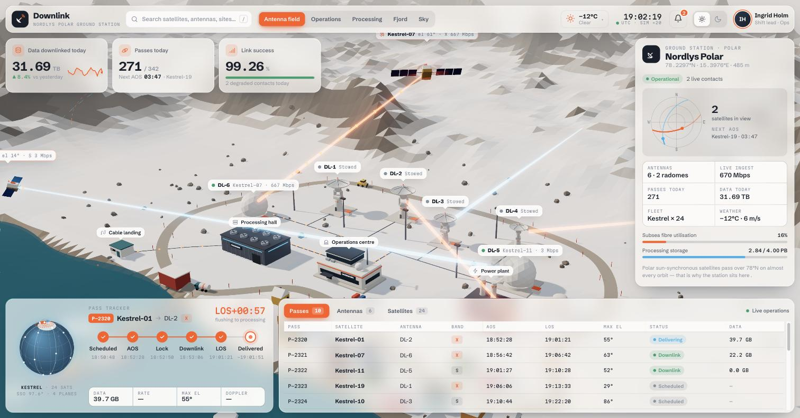
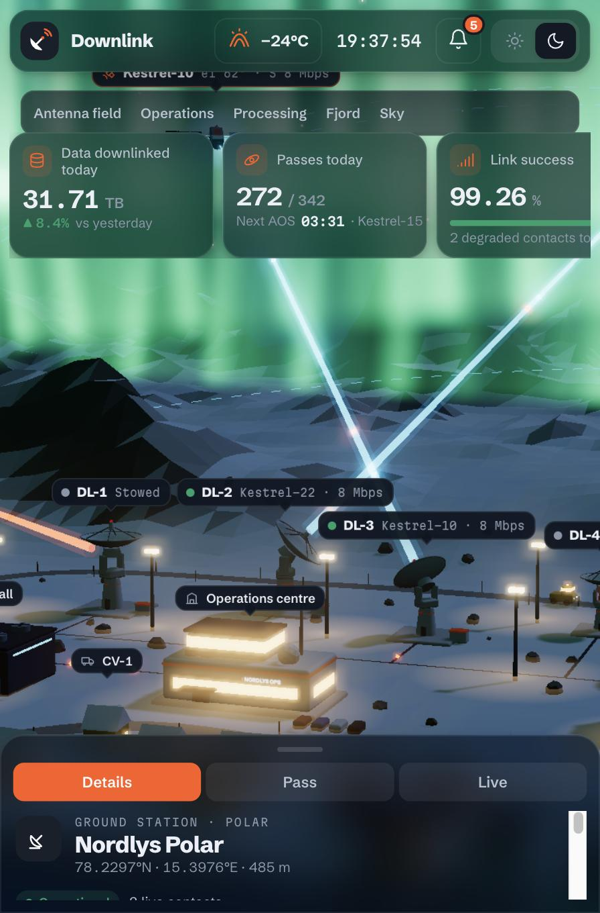

# Downlink — Nordlys Polar Ground Station

A live 3D satellite ground-station dashboard that plays like a strategy game. One HTML file, Three.js from a CDN, no build step and no external 3D models: every antenna, satellite and building is generated in code.





## Run it

Open `index.html` in a modern browser, or serve the folder:

```bash
python3 -m http.server 8000
# then open http://localhost:8000
```

## What's inside

| Block | What it does |
|---|---|
| **World** | Low-poly Arctic plateau on a fjord: 6 tracking antennas (2 inside radomes), operations centre, processing hall, power plant, subsea cable landing, harbour and a small village. |
| **Life** | 24 fictional Earth-observation satellites (Kestrel-01…24) pass overhead on a shared schedule: pre-position → AOS → lock → downlink → LOS → delivered. Data packets flow satellite → dish → fibre → processing → subsea cable. Vehicles keep their distance and yield; a supply ship docks and leaves. |
| **Interaction** | Drag to pan, right-drag to rotate, scroll or pinch to zoom. Click anything and the camera flies to it and follows it. Area switcher and search (`/`). |
| **Dashboard** | Frosted-glass panels: KPIs, detail panel with a live sky plot, pass tracker with a mini constellation globe, and live tables (passes, antennas, satellites). |
| **Extras** | Clear, Snowfall (Ka-band rain fade), Polar night (aurora borealis) and Solar storm (link drops and alerts); animated day/night; mobile layout with a bottom sheet. |

All names, satellites and figures are fictional.

## Credits

Built on the five-block world structure (world, life, interaction, dashboard, extras) popularised by the World Prompt Pack from [@sanjai.builds](https://www.instagram.com/sanjai.builds/).
